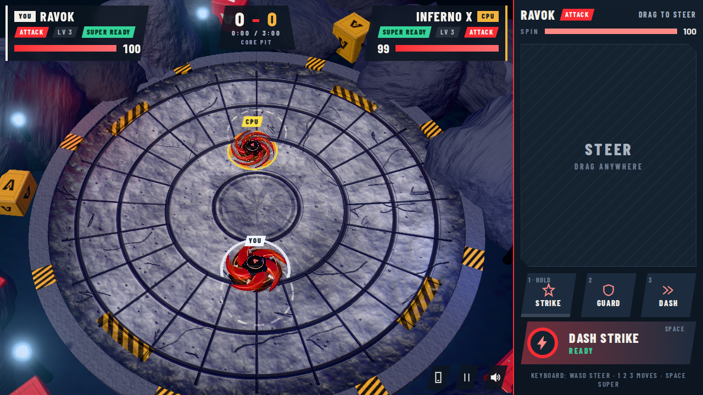
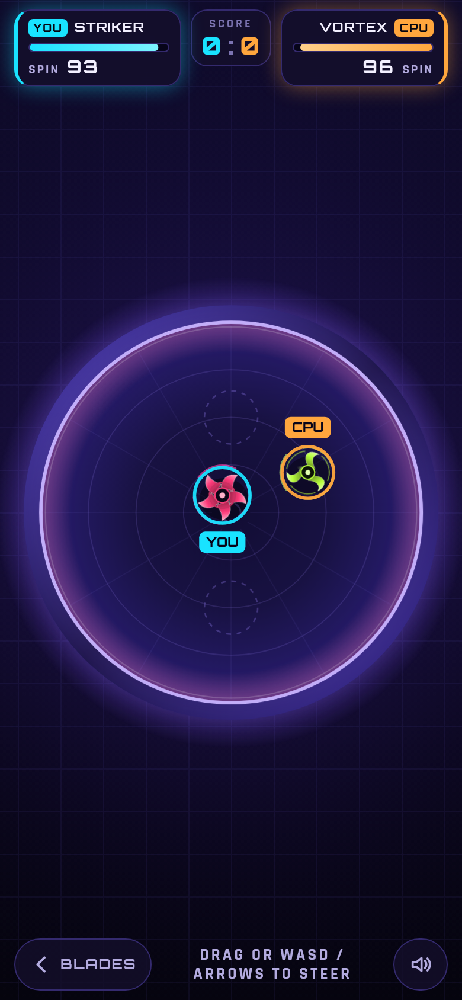
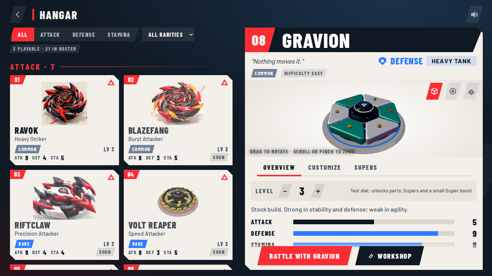

# Spinblade Arena

Spinblade Arena is a 3D, top-down spinning-blade duel for the browser. Two blades slingshot into a pit, and one wins by pushing the other over the rim or by running it out of spin. I built it from a PRD and a blade-and-skills spec to see how much weight, legibility and balance a browser-only game could carry without a server.

## Overview

You launch by pulling back and releasing, then steer with a floating stick while three moves and a Super sit on a pad beside the arena. The loop is menu, launch, battle, result, rematch.

At first only three of the 21 blades in the roster were playable: Ravok (Attack), Gravion (Defense) and Phantom (Stamina). A commit on 20 October added moves, Supers and effects for all 21, and the Hangar now reads 21 playable. Everything is bundled, nothing is fetched at runtime, and nothing is stored.

## The idea

A fight this short has to stay readable on a phone. When a blade loses, the player should know why, and the blades should relate to each other in a way that can be learned in a round or two.

## What I was testing

- Whether a counter-triangle (Attack beats Stamina, Stamina beats Defense, Defense beats Attack) can emerge from ratings and physics instead of per-blade code.
- Whether the end of a fight can explain itself: a chip, a sentence and a banner name the ring-out or spin-out at the moment it happens.
- Whether the controller and the arena can be separate parts from the start. A phone icon opens the pad in a second tab, talking to the arena over a BroadcastChannel, which is the shape of the next phase.

## Process

The first version was a single-file 2D prototype, which is still playable in the repository. Version 2 moved to 3D with Three.js and the Rapier physics engine. The spec asked for a top-down camera, so the gameplay stays planar and the 2D design intent holds. The PRD decision that said 2D needs updating.

Everything is data: blades, moves, Supers, parts and arenas are tables. The simulation runs on a fixed 120 Hz step with no DOM, so the same code runs in the browser, in the tests and in a headless balance script.

Balance was the long part. The first triangle was 100% against 0%, and it came back whenever fights got longer, because a steady stat edge in passive decay wins every long fight. I fixed it with global knobs and three small rating changes, not blade-specific code. At the default level each counter wins 73 to 87% of CPU-against-CPU fights, from both seats. Those tables still cover the first three blades.

The latest pass, on 20 October, is visual and audio only, so the balance numbers did not move. A fast blade stands upright, and a slowing one leans and precesses like a gyroscope before it topples onto its rim. Sparks are real 3D streaks that cool from white-hot to dull red, and hits leave scratches on the floor that fade. Sound is synthesised: a struck-metal collision, a grinding loop, and a whirr per blade that follows its spin.

*Caption: A battle in the latest build, Ravok against a CPU Inferno X. The arena is on the left and the controller pad, with its moves and Super, is a separate panel on the right.*

The first version, for comparison, was a flat 2D arena.

*Caption: Version 1, the 2D prototype.*

## Result

A playable MVP: a Hangar with all 21 blades playable, a Workshop with about 35 parts, Supers, and a CPU with Easy, Normal and Hard states. The result screen names the cause of a loss and where the spin went. One self-contained HTML file can be built with `npm run build:single`. There is no hosted version linked yet.

*Caption: The Hangar in the latest build. The counter at the top reads 21 playable, 21 in roster.*

## Learnings

- Hit-stop makes hits feel heavy, but only if it fires on big hits and never twice within half a second. Before that rule, a clash that kept re-contacting froze the game over and over.
- Faster controls broke the balance: Ravok against Phantom jumped to 97% because of first-clash ring-outs, until I retuned the agility curve and Phantom's weight.
- The player's blade gets a small assist the CPU does not, so the CPU table understates how strong a human is. Giving the CPU the same assist turned every matchup into a coin flip.
- In the three-blade balance runs, the Attack counter does not hold at Hard difficulty (Ravok against Phantom wins 43%), and Gravion never rings anyone out in CPU play. Both need their own pass. The 21-blade roster has a balance harness now, but the README's tables still cover the first three.
- Not measured yet: frame rate on a real GPU, since I only ever ran it in a software-rendered browser, and win rates for real players. I checked the sounds by rendering them offline and have not heard them through speakers.
- The newest commits are marked work in progress, covering arena mechanics and a progression core. The README has not caught up with them.

## Notes

A blade left alone spins for up to three minutes, depending on its Stamina rating, and the round stops at 3:00. A `?quality=` switch picks one of three graphics tiers, and `?reduced=1` removes hit-stop and calms the camera. Textures are generated when the game loads, so there are no image files in the 3D scene.
