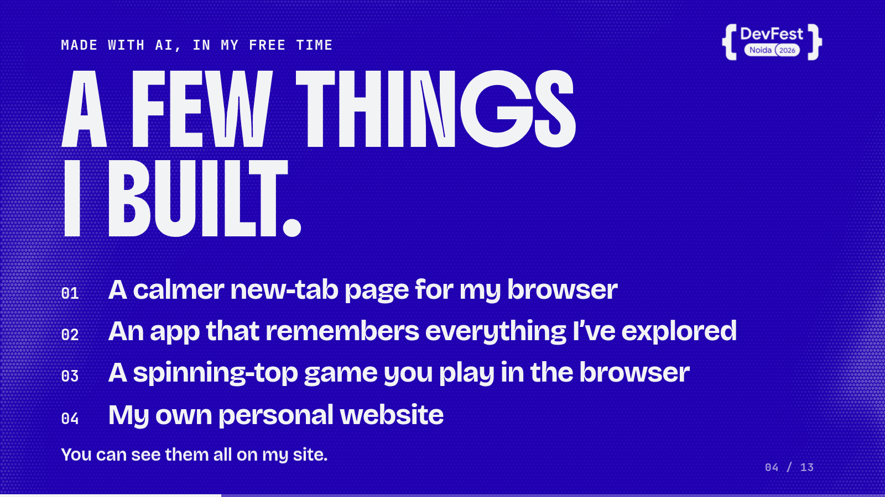
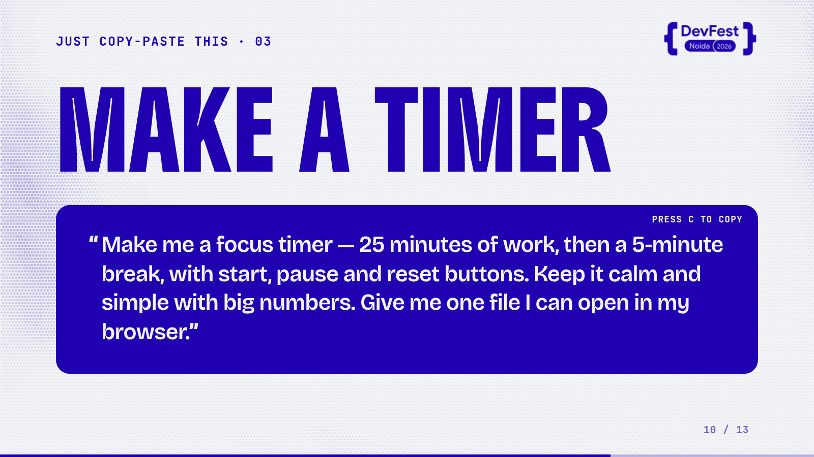

# AI Playground deck

This is the slide deck I built for a workshop at Google DevFest 2026, run by Google Developer Groups Noida. I wanted to see whether a deck could demonstrate its own message: that someone who can't really code can describe an idea to an AI, get something working, fix it and repeat. It is one HTML file with 13 slides.

## Overview

The talk is one argument in three steps. I am a designer and not a coder, and I always had ideas I couldn't build. Here are four things I built with AI in my free time. Then the method on a single slide: describe it, let AI build it, fix it, repeat.

After that the audience picks one thing to build, opens a free AI, pastes a few lines and gets their own: a website, a game or a timer. The last slide asks them to go make one small thing this week.

## The idea

I wanted the talk to start from a person and not a tool: someone who says "I can't really code" and still ends up with working things. That meant short slides, very large type and prompts the audience can copy, with the proof, the four projects, shown early. The slide that lists them ends with "You can see them all on my site."

## What I was testing

- Whether big type and two colours are enough to carry a talk. The deck began as text only and ended as a deep blue and off-white system with capital headings, a halftone texture and a kinetic intro.
- Whether a prompt on a slide can be something the audience actually uses. Each example has a prompt card with "press C to copy", and the text appears as it is typed.
- Whether a slide can be live. After "Make a timer" there is a working Pomodoro timer slide.

## Process

All eight commits are from 9 October. The first was a text-only deck. The second redesign brought colour-block themes, variable bold type, a kinetic intro and a LinkedIn QR code on the last slide. Later passes moved to bold capital headings and halftone backgrounds, then to a two-colour system of deep blue and off-white with a calmer texture. The DevFest logo was recoloured to follow the theme and added to every slide, and the live timer slide came last.

*Caption: The proof slide. The four things are Inspira, AI Brain, Spinblade Arena and my own site, all of which are in this archive.*

## Result

The deck is complete at 13 slides and moves with the arrow keys, with a slide counter and a progress bar. It is a single file that loads nothing from the network, so it works offline. There is no hosted version linked yet.

*Caption: Every example slide carries a prompt the audience can copy.*

## Learnings

- The final commit fixed prompt text that vanished after the first few words. The prompt cards are the core of the talk, so that was the bug that mattered.
- The first redesign used several colour-block themes. The deck settled on two colours and a calmer texture.
- The repository has no README, so the event date and any hosted link are not recorded anywhere I can check.

## Notes

The first slide scrambles its subtitle before settling, which is the kinetic intro. The title slide names the presenter and neelesh.one.
