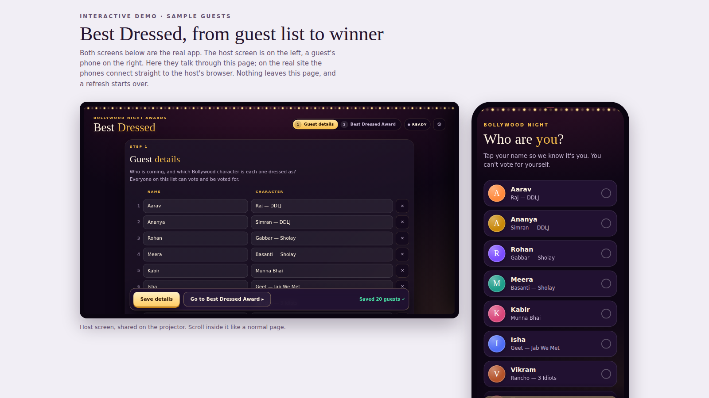
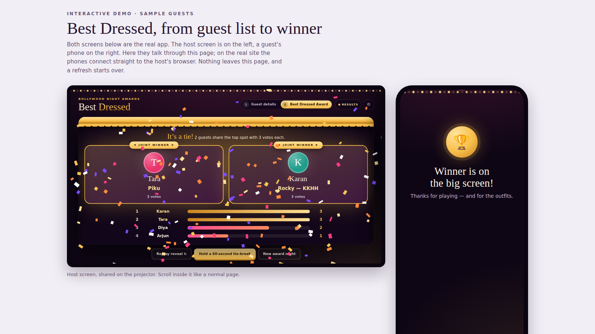

# Bollywood Night Awards

This is a small web app for running a live Best Dressed vote at a Bollywood-themed party. The host shares a laptop screen on the projector, guests scan a QR code and vote on their own phones, and nobody sees a score until the host opens a curtain. I wanted to see how much of a live voting night could work with no backend at all.

## Overview

The host opens the site and enters each guest's name and the Bollywood character they are dressed as, or pastes a list. On the Best Dressed page a QR code is already on screen, so guests can scan it and pick their name while the host sets up. The host chooses a 2-minute or 5-minute clock and starts voting, and a countdown runs on the projector and on every phone.

At zero, voting closes by itself. Reveal Winner plays a drumroll and a curtain, then shows the winner with confetti. The app lives in the `bollywood-vote` folder of the Game-Design repository, next to Spinblade Arena.

## The idea

I wanted a vote that feels like part of the show. Scores stay hidden until a reveal with a curtain, and the setup stays short: there is no login, database or build step.

## What I was testing

- Whether phones can send votes straight to the host's browser with no server, database or sign-in.
- Whether hiding every score until the reveal keeps the vote fun and fair.
- Whether a tie can be handled honestly, without a coin toss.

## Process

A QR code alone cannot carry votes back to the host, because browser storage belongs to one device. So each phone connects directly to the host's browser over WebRTC. The host page is the server: it holds the guest list and votes in `localStorage`, runs the voting rules and answers the phones.

The QR code carries the host's short connection code. A phone that scans it asks PeerJS's free public broker to introduce it to the host, then talks to the host directly. The broker only passes connection details, and names and votes never go through it.

The voting rules sit in one small file with tests, and the phone-to-host link is tested against a fake PeerJS network. The repository also builds a click-through demo that shows the host screen and a phone side by side with sample guests.

*Caption: Step one, the guest list, with a guest's phone beside it. This is the repository's own demo, with sample guests.*

The design changed course over two days. On 29 October it moved from a hosted-first version with a live leaderboard to a static site with hidden results, and the last commit was a design pass with new fonts, a new palette, aligned layouts and an optional stage backdrop.

## Result

A complete static site that deploys to Vercel's free plan or any static host: a host page, a guest page, the QR code, the countdown, hidden results, the curtain reveal and tie handling. There is no hosted copy linked yet.

A tie is never settled at random. The reveal shows joint winners, or the host can hold a 60-second tie-break that puts only the tied guests on everyone's phone for one more vote.

Guests first tap their own name. A name can be picked on one phone only and each phone votes once, which also stops people voting for themselves.

*Caption: The reveal, with a tie. The sample votes in the demo produced two joint winners, so the tie-break button is showing.*

## Learnings

- Browser storage is per device, so the QR code has to carry a connection code and WebRTC does the rest.
- Everyone needs an internet connection, and a few locked-down networks block WebRTC. The host tab has to stay open while voting runs.
- Duplicate-vote protection runs in the browser, so it relies on honesty. If someone picks the wrong name or switches phones, the host releases the name.

## Notes

The titles use Rozha One and the text uses Plus Jakarta Sans, both loaded from Google Fonts, with a palette of midnight plum, marigold gold, rani pink and a velvet-maroon curtain. A 16:9 stage picture can be dropped in as a backdrop. The QR code and PeerJS libraries are bundled.

The screenshots were taken offline, so they show fallback fonts and not the Google Fonts the app asks for.
